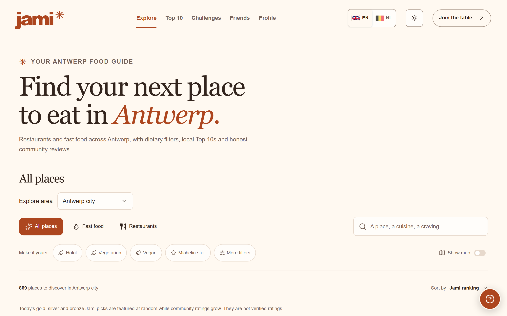
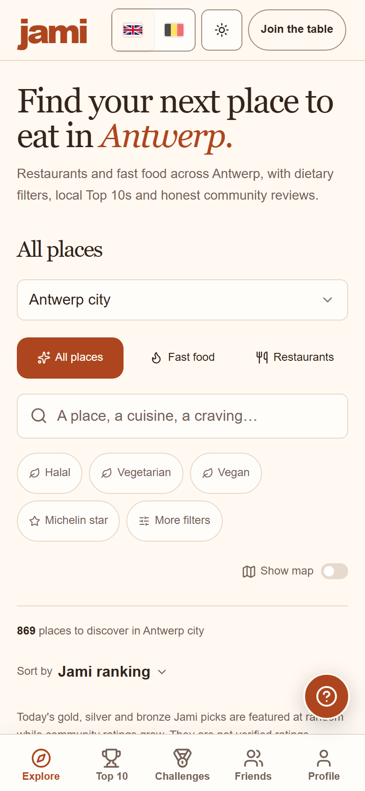

  

<h1 align="center">Jami — your Antwerp food guide</h1>

  <strong><a href="https://www.jami.life">www.jami.life</a></strong> 
  Restaurants and fast food across Antwerp, with dietary filters, local Top 10s and honest community reviews.

---

## What Jami does

- **Discover places to eat** across Antwerp city and province: more than 2,100 verified restaurants and fast-food spots, each with a cuisine and an address.
- **Filter the way you eat**: halal, vegetarian, vegan, MICHELIN and Gault&Millau distinctions, and more.
- **Top 10 guides** by category and neighbourhood, ranked by Jami's own community ratings.
- **Reviews you can trust**: members rate food, hygiene, service and ambiance, and reviews linked to a confirmed visit carry more weight.
- **Pick for me**: can't decide? Jami chooses a place for you, optionally within 3 km.
- **Profiles, levels and challenges**: earn XP for places you visit and review, unlock tiers from Bronze to Ruby, follow friends and collect monthly badges.
- **English and Flemish Dutch**, light and dark mode, and a phone layout built to feel like an app.

## Screenshots

| Phone | Places | Top 10 | Nederlands |
|---|---|---|---|
|  |  |  |  |

## Built with

Next.js · React · TypeScript · Supabase · Vercel

Place data © [OpenStreetMap](https://www.openstreetmap.org/copyright) contributors (ODbL).

---

This repository is a showcase only. The source code of Jami is private.

© 2026 Jami. All rights reserved. See [LICENSE](LICENSE).
