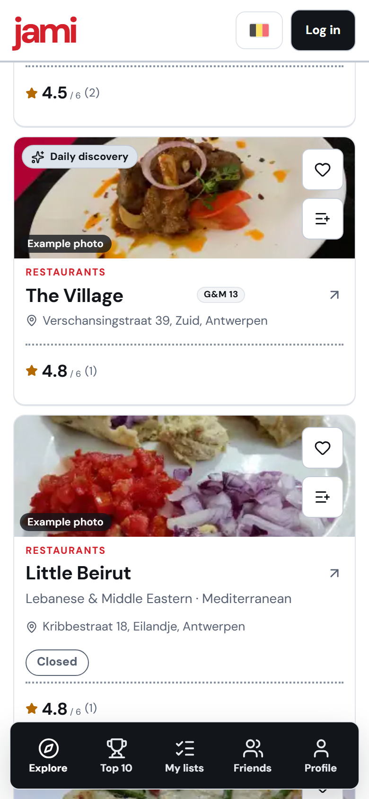
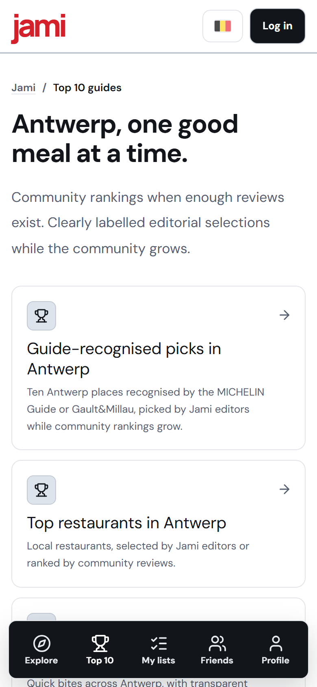
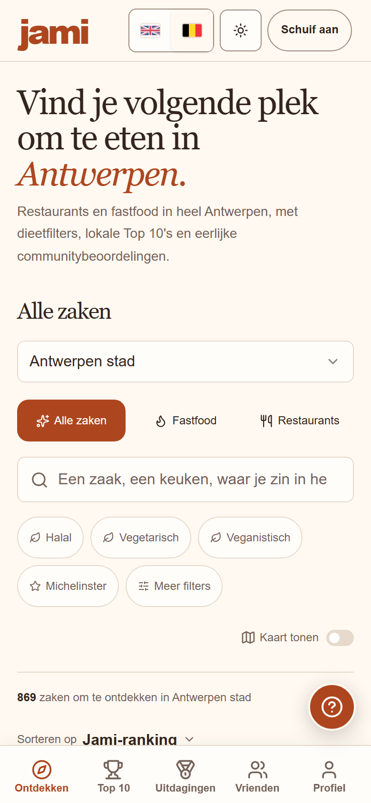
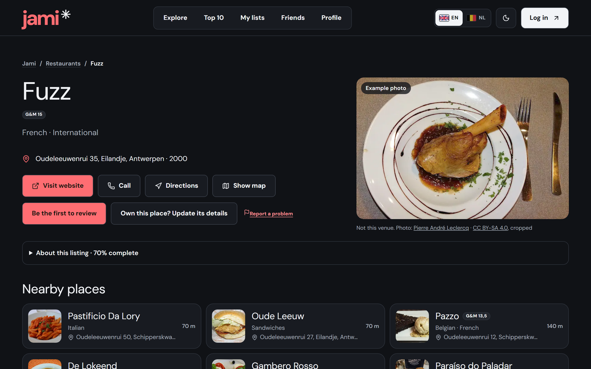

  

<h1 align="center">Jami: your Antwerp food guide</h1>

  <strong><a href="https://www.jami.life">www.jami.life</a></strong> 
  Restaurants and fast food in Antwerp, with honest reviews.

---

## What Jami does

- **Discover places to eat** across Antwerp city and province: more than 2,200 restaurants and fast-food spots, each with a cuisine, an address and a photo.
- **Guide distinctions**: 222 restaurants with a Gault&Millau score, plus MICHELIN stars and Bib Gourmands, each shown with a fine-dining photo.
- **Filter the way you eat**: halal, vegetarian, vegan, open now, delivery, guide distinctions and more. Dietary tags come only from source data, never guessed.
- **Quick picks**: Near me, Surprise me, Pick for me, and a **group vote**: share a link and let friends vote on where to eat, no account needed.
- **Top 10 guides** by category and neighbourhood, ranked by Jami's own community ratings once enough reviews exist.
- **Reviews you can trust**: members rate food, hygiene, service and ambiance from 1 to 6 stars, in half-star steps. Reviews linked to a location-confirmed visit carry more weight.
- **Likes and lists**: like places, collect them in private or public lists, and save other members' public lists.
- **Profiles, levels and challenges**: earn XP for places you visit and review, unlock tiers from Bronze to Ruby, follow friends, see where they have been and collect monthly badges.
- **English and Flemish Dutch**, light and dark mode, and a phone layout built to feel like an app.
- **Privacy first**: no advertising trackers and cookieless visit statistics.

## Screenshots

| Phone | Places | Top 10 | Nederlands |
|---|---|---|---|
|  |  |  |  |

## Built with

Next.js · React · TypeScript · Supabase · Vercel

Place data © [OpenStreetMap](https://www.openstreetmap.org/copyright) contributors (ODbL). Guide distinctions from the MICHELIN Guide and Gault&Millau Belux. Example food photos are freely licensed (Wikimedia Commons) and credited on [www.jami.life/photo-credits](https://www.jami.life/photo-credits).

---

This repository is a showcase only. The source code of Jami is private.

© 2026 Jami. All rights reserved. See [LICENSE](LICENSE).
